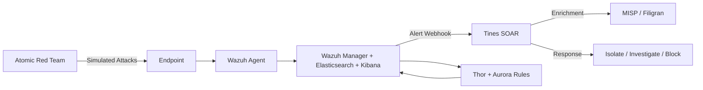

# Home Lab SOC: Wazuh SIEM + Tines SOAR + Threat Intel

I'm building a self-hosted security operations pipeline built to detect, enrich, and respond to endpoint threats. The plan is to test with Atomic Red Team and integrate it with MISP threat intelligence platform which I already have running sometimes.

* You can see previous commits of this readme for an earlier start that I abandoned, and a first pass README written by AI.
* I decided I wanted to write the docs myself.

## Step 1: Install Wazuh

* Since I have 24 GB of RAM on my main computer, I decided to run most of the lab on it. Decided on Hyper-V and downloaded the Wazuh OVA. Decisions on architecture were based on discussion with AI.

## Architecture (future)



## The Stack Plan

| Tool | Purpose |
|------|---------|
| **Wazuh** | SIEM, EDR, log management, and alert correlation |
| **Tines** | SOAR — alert triage, automated response playbooks |
| **Atomic Red Team** | Detection testing framework for validating alerts |
| **MISP / Filigran** | Threat intel enrichment for alert context |
| **Thor + Aurora** | YARA-based hunting and process/network telemetry |
| **Sysmon** | Windows endpoint telemetry (process, network, registry) |

## What It Should Catch

* Brute Force
* Lateral Movement
* Credential Dumping
* Command and Control

## Quick Start

### Running the Demo

```bash
To be determined.
```

TODO: Record a 60-second screen capture showing the full flow — that's your portfolio highlight reel.

## Challenges & Tuning

## Future Work

- [ ] Add Zeek for network telemetry
- [ ] Expand Tines playbook library (malware sandboxing, user deprovisioning)
- [ ] Slack/Teams alert channel integration

## Disclaimer

This is a home lab environment for educational and portfolio purposes. Not configured for production use.

## License

MIT — see [LICENSE](LICENSE) for details.
