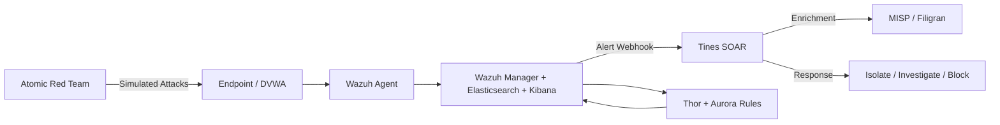

# Home Lab SOC: Wazuh SIEM + Tines SOAR + Threat Intel

I'm building a self-hosted security operations pipeline built to detect, enrich, and respond to endpoint threats. The plan is to test with Atomic Red Team and integrate it with MISP threat intelligence platform which I already have running sometimes.


## Architecture



## The Stack Plan

| Tool | Purpose |
|------|---------|
| **Wazuh** | SIEM, EDR, log management, and alert correlation |
| **Tines** | SOAR — alert triage, automated response playbooks |
| **Atomic Red Team** | Detection testing framework for validating alerts |
| **MISP / Filigran** | Threat intel enrichment for alert context |
| **Thor + Aurora** | YARA-based hunting and process/network telemetry |
| **Sysmon** | Windows endpoint telemetry (process, network, registry) |

## What It Should Catch

* Brute Force
* Lateral Movement
* Credential Dumping
* Command and Control

## Quick Start

> Minimal viable setup for local testing.

### Prerequisites
- Virtualization host (Hyper-V)
- 16 GB+ RAM recommended for Wazuh OVA
- Windows endpoint for agent + Sysmon + Thor

### Setup

```bash
# 1. Deploy Wazuh OVA to your hypervisor
#    Default creds, then change the admin password

# 2. Enroll your endpoint
#    Generate agent key in Wazuh → install agent on Windows host

# 3. Install Sysmon + Thor + Aurora
#    Configure Sysmon with SwiftOnSecurity's baseline
#    Deploy Thor rules and Aurora agent

# 4. Deploy Tines
#    Community edition or cloud trial
#    Create incoming webhook story

# 5. Wire Wazuh → Tines
#    Configure Wazuh integration to POST alerts to Tines webhook

# 6. Deploy DVWA
#    Isolated VM or container for attack simulation

# 7. Run your first Atomic Red Team test
#    powershell -Command "Invoke-AtomicTest T1110.001"
#    Watch alert appear in Kibana → trigger Tines story
```

See [`docs/setup/`](docs/setup/) for detailed step-by-step guides.

## Detection Testing

| Atomic Test | MITRE Technique | Wazuh Alert | Thor Match | Tines Triggered | Tuned |
|-------------|-----------------|-------------|------------|-----------------|-------|
| T1110.001 - Password Spraying | Brute Force | ✅ | — | ✅ | FP threshold |
| T1059.001 - PowerShell Encoded | Command & Scripting | ✅ | ✅ | ✅ | Exclusion added |
| T1047 - WMI Remote Execution | System Owner/User Discovery | ✅ | — | ✅ | — |
| T1003.001 - LSASS Memory | OS Credential Dumping | ✅ | ✅ | ✅ | — |
| T1021.002 - SMB/Windows Admin Shares | Remote Services | ✅ | — | ✅ | Rate limit |

*Table shows sample results — replace with your actual test outcomes.*

### Running a Test

```powershell
# From an endpoint enrolled in Wazuh
IEX(New-Object Net.WebClient).DownloadString('https://raw.githubusercontent.com/redcanaryco/invoke-atomicredteam/master/AtomicTestHarnesses/Invoke-AtomicTestHarnesses.ps1')
Invoke-AtomicTest T1110.001
```

Then confirm the alert in Kibana and watch the Tines story execute.

## Threat Intel Integration

MISP enriches every high-confidence Wazuh alert before Tines routes it.

### Enrichment Flow

1. Wazuh alert fires with IOC (IP, hash, domain)
2. Tines story queries MISP for matching attributes
3. If found: attaches threat actor names, campaign tags, related malware
4. Alert is scored and routed: high-confidence → auto-response, low → human review

### Example Enriched Alert

```
[Wazuh] Alert: Failed login brute force
Source IP: 192.168.1.50
[MISP Enrichment]
  - Attribute match: 192.168.1.50
  - Threat Actor: APT29
  - Campaign: XYZ-2024
  - Malware: WellMess
[Tines Decision] Score: 8/10 → Isolate endpoint, block IP
```

See [`docs/misp/`](docs/misp/) for integration setup.

## Demo Walkthrough

### Scenario: Brute Force → Detection → Response

**Step 1 — Simulate attack**
Run Atomic Red Team password spray against DVWA.

**Step 2 — Detect**
Wazuh auth rule fires. Screenshot of Kibana dashboard showing the alert with source IP, timestamps, and rule metadata.

**Step 3 — Enrich**
Tines queries MISP, finds the IP tagged to a known threat actor. Screenshot of Tines story execution log.

**Step 4 — Respond**
Tines auto-isolates the endpoint (or triggers a manual review workflow). Screenshot of the action log.

**Step 5 — Document**
All events stored in Wazuh. Alert timeline viewable in Kibana. Tines story run history saved for audit.

### Running the Demo

```bash
To be determined.
```

TODO: Record a 60-second screen capture showing the full flow — that's your portfolio highlight reel.

## Challenges & Tuning

## Future Work

- [ ] Add Zeek for network telemetry
- [ ] Expand Tines playbook library (malware sandboxing, user deprovisioning)
- [ ] Slack/Teams alert channel integration

## Disclaimer

This is a home lab environment for educational and portfolio purposes. Not configured for production use.

## License

MIT — see [LICENSE](LICENSE) for details.
