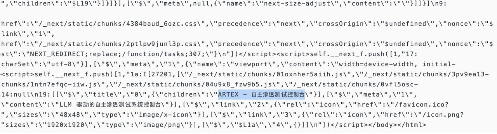
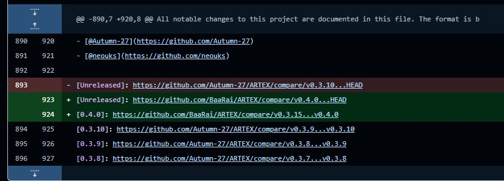

<i>This post originally appeared on LinkedIn on November 11, 2026. Modified November 22, 2026</i>

BLUF:

Artex doesn't introduce new attacker techniques; it automates known ones. Behavioral detections on enumeration, BloodHound collection and lateral movement remain the durable control, while infrastructure indicators are noisy because many exposed instances could be the work of researchers.

ARTEX, the Autonomous Offensive Framework (#AOF) currently making waves in the cybersecurity landscape, was first created as cybersecurity #pentesting tool in July 2026. (High confidence)

In August into September 2-3, it took part in and won the 1st #Baidu Agent+ Attack-Defense Capability Challenge hosted by the Baidu Security Response Centre. (High Confidence)

While creator Autumn-27 took the repo down on October 8 due to the malicious use of their tool by hackers, the project reportedly used in the competition is still public and still being developed, but no additional commits have been made by Autumn-27. At least 3 other developers have contributed. The version that was publicly available at the time of the competition was v0.3.7.

A number of forks of the original repo exist, including an English translation by BaaRai now standing at v0.6.0, which was released last week. It now has over 4000 forks. The Chinese version has 14. But are these forks legitimate?

An investigation into the commit history (shown in one of the images here) shows the v0.4.0 branch of BaaRai's Artex aligns with changes made immediately after 0.3.7. Changes of the English repo continue up to v0.6.0. A comparison of code mentioned in the competition results announcement commenting on `agent/toolcatalog.go:59` match code in BaaRai's fork, providing high confidence that the repo is a legitimate continuation of the original Artex. 

BaaRai's fork is an improved, hardened version of Artex, so it is likely it will continue to be used by threat actors in future attacks.

Norma is a Github project by Autumn-27 which is an AI harness written in Go and is a dependency of Artex. It is in active development (High confidence).

The primary source of references to Artex being used in Korean financial breaches comes from this linked in post: https://lnkd.in/p/guRnDNW3 (High confidence).

For protection steps, see the FBI Flash and the Palo-Alto coverage from November 11: https://lnkd.in/gtBN7AVQ

Bonus: Sooo much info in a Chinese WeChat post: https://lnkd.in/g4KxNrWD

